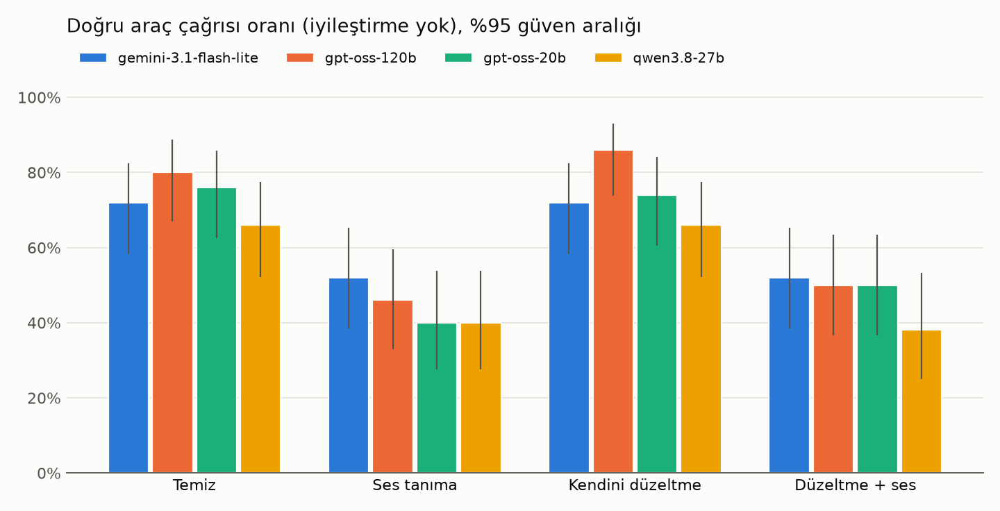
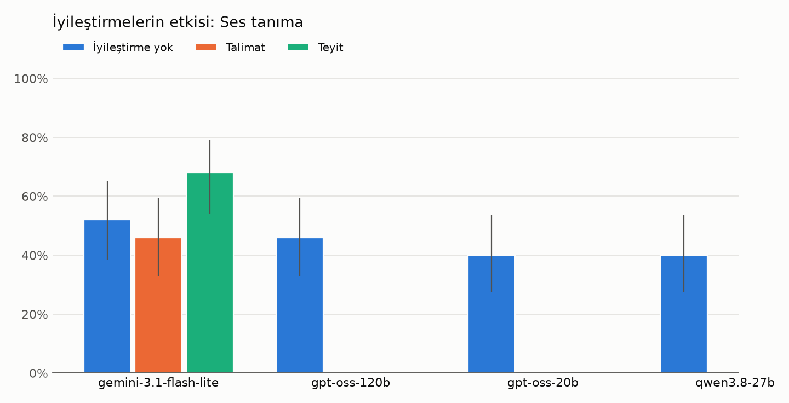
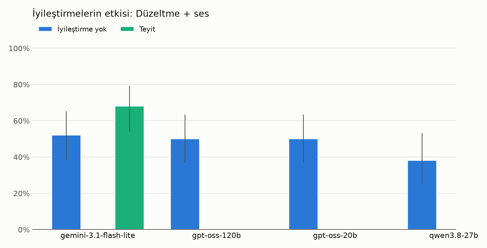

# Sonuçlar

Ana tablolar 50 cevap anahtarlık sabit alt kümeden (`data/subset.txt`); her hücre aynı konuşmalar.

## Ses tanıma zinciri

| Koşul | Konuşma | Ort. kelime hata oranı | Numara/kod bozulmadan ulaştı |
|---|---:|---:|---:|
| Ses tanıma | 100 | 18.1% | 70% (52/74) |
| Düzeltme + ses | 85 | 21.0% | 73% (54/74) |

## Duyduğuna mı, kastedilene mi göre davrandı?

Ses koşulları, numara ve kodların ses tanımadan bozulmadan geçip geçmediğine göre ayrıldı. Bozuk satırda doğru cevap ancak model sorup doğrusunu öğrenirse mümkün; *yanlış değerle işlem* müşterinin söylemediği bir numarayla kayıt değiştirmek demek.

| Model | İyileştirme | Numara/kod | n | Doğru | Yanlış değerle işlem | Sordu | Diğer |
|---|---|---|---:|---:|---:|---:|---:|
| gemini-3.1-flash-lite | İyileştirme yok | sağlam | 60 | 77% | 3% | 17% | 3% |
| gemini-3.1-flash-lite | İyileştirme yok | **bozuk** | 24 | 0% | 33% | 58% | 8% |
| gemini-3.1-flash-lite | Talimat | sağlam | 29 | 72% | 3% | 24% | 0% |
| gemini-3.1-flash-lite | Talimat | **bozuk** | 13 | 0% | 38% | 46% | 15% |
| gemini-3.1-flash-lite | Teyit | sağlam | 60 | 80% | 5% | 0% | 15% |
| gemini-3.1-flash-lite | Teyit | **bozuk** | 24 | 42% | 29% | 17% | 12% |
| gpt-oss-120b | İyileştirme yok | sağlam | 60 | 68% | 8% | 22% | 2% |
| gpt-oss-120b | İyileştirme yok | **bozuk** | 24 | 0% | 33% | 58% | 8% |
| gpt-oss-20b | İyileştirme yok | sağlam | 60 | 68% | 13% | 13% | 5% |
| gpt-oss-20b | İyileştirme yok | **bozuk** | 24 | 0% | 71% | 17% | 12% |
| qwen3.8-27b | İyileştirme yok | sağlam | 55 | 56% | 2% | 18% | 24% |
| qwen3.8-27b | İyileştirme yok | **bozuk** | 23 | 4% | 48% | 43% | 4% |

### İyileştirmeler aynı konuşmalarda fark yarattı mı?

| Model | İyileştirme | Koşul | Satırlar | n | Yok → var | Kazandı | Kaybetti | p (McNemar) |
|---|---|---|---|---:|---|---:|---:|---:|
| gemini-3.1-flash-lite | Teyit | Ses tanıma | hepsi | 50 | 52% → 68% | 12 | 4 | 0.077 |
| gemini-3.1-flash-lite | Teyit | Ses tanıma | bozuk numara | 13 | 0% → 46% | 6 | 0 | 0.031 |
| gemini-3.1-flash-lite | Teyit | Düzeltme + ses | hepsi | 50 | 52% → 68% | 13 | 5 | 0.096 |
| gemini-3.1-flash-lite | Teyit | Düzeltme + ses | bozuk numara | 11 | 0% → 36% | 4 | 0 | 0.125 |
| gemini-3.1-flash-lite | Talimat | Ses tanıma | hepsi | 50 | 52% → 46% | 1 | 4 | 0.375 |
| gemini-3.1-flash-lite | Talimat | Ses tanıma | bozuk numara | 13 | 0% → 0% | 0 | 0 | 1.000 |

### Teyit neden yetmedi

Teyit, numarası bozuk gelen 24 satırda; başarısız olanların nedeni takip konuşmasından çıkarıldı.

| Sonuç | Satır |
|---|---:|
| Doğru | 10 |
| Simüle müşteri yanlış okumayı onayladı | 6 |
| Müşterinin düzeltmesi de yanlış duyuldu | 5 |
| Değer geri okunmadı | 3 |

## Doğru araç çağrısı oranı

| Model | İyileştirme | Koşul | n | Doğru | %95 GA | İlk cevap p50 / p95 (s) | Ek tur | Sorup bıraktı | Düzeltilmişi değil ilkini aldı |
|---|---|---|---:|---:|---|---|---:|---:|---:|
| gemini-3.1-flash-lite | İyileştirme yok | Temiz | 50 | 72% | 58%–83% | 0.9 / 25.6 | 0.00 | 9 | 0 |
| gemini-3.1-flash-lite | İyileştirme yok | Ses tanıma | 50 | 52% | 39%–65% | 0.8 / 6.2 | 0.00 | 13 | 0 |
| gemini-3.1-flash-lite | İyileştirme yok | Kendini düzeltme | 50 | 72% | 58%–83% | 1.0 / 15.5 | 0.00 | 12 | 0 |
| gemini-3.1-flash-lite | İyileştirme yok | Düzeltme + ses | 50 | 52% | 39%–65% | 2.8 / 14.8 | 0.00 | 16 | 0 |
| gemini-3.1-flash-lite | Talimat | Ses tanıma | 50 | 46% | 33%–60% | 1.4 / 33.3 | 0.00 | 17 | 0 |
| gemini-3.1-flash-lite | Teyit | Ses tanıma | 50 | 68% | 54%–79% | 1.9 / 28.8 | 1.42 | 2 | 0 |
| gemini-3.1-flash-lite | Teyit | Düzeltme + ses | 50 | 68% | 54%–79% | 2.0 / 32.2 | 1.32 | 2 | 1 |
| gpt-oss-120b | İyileştirme yok | Temiz | 50 | 80% | 67%–89% | 0.6 / 2.9 | 0.00 | 5 | 0 |
| gpt-oss-120b | İyileştirme yok | Ses tanıma | 50 | 46% | 33%–60% | 0.5 / 3.6 | 0.00 | 13 | 0 |
| gpt-oss-120b | İyileştirme yok | Kendini düzeltme | 50 | 86% | 74%–93% | 0.6 / 2.4 | 0.00 | 4 | 0 |
| gpt-oss-120b | İyileştirme yok | Düzeltme + ses | 50 | 50% | 37%–63% | 0.6 / 2.0 | 0.00 | 16 | 0 |
| gpt-oss-20b | İyileştirme yok | Temiz | 50 | 76% | 63%–86% | 0.5 / 3.4 | 0.00 | 5 | 0 |
| gpt-oss-20b | İyileştirme yok | Ses tanıma | 50 | 40% | 28%–54% | 0.4 / 1.8 | 0.00 | 7 | 0 |
| gpt-oss-20b | İyileştirme yok | Kendini düzeltme | 50 | 74% | 60%–84% | 0.5 / 3.4 | 0.00 | 3 | 0 |
| gpt-oss-20b | İyileştirme yok | Düzeltme + ses | 50 | 50% | 37%–63% | 0.5 / 1.2 | 0.00 | 8 | 0 |
| qwen3.8-27b | İyileştirme yok | Temiz | 50 | 66% | 52%–78% | 3.2 / 3.6 | 0.00 | 8 | 0 |
| qwen3.8-27b | İyileştirme yok | Ses tanıma | 50 | 40% | 28%–54% | 0.4 / 0.5 | 0.00 | 13 | 0 |
| qwen3.8-27b | İyileştirme yok | Kendini düzeltme | 50 | 66% | 52%–78% | 0.4 / 0.7 | 0.00 | 9 | 0 |
| qwen3.8-27b | İyileştirme yok | Düzeltme + ses | 42 | 38% | 25%–53% | 0.4 / 0.8 | 0.00 | 11 | 0 |

## Yapmadığı işlemi yaptım dedi

Kural: cevap bir işlemin yapıldığını söylüyor (`report.CLAIM`) ama kayıt değiştiren bir araç çağrısı yok. Kural, elle etiketlenen 40 örnekte görülen kalıplardan yazıldı; aşağıdaki uyum değeri bu yüzden iyimser.

| Model | Temiz | Ses tanıma | Kendini düzeltme | Düzeltme + ses |
|---|---:|---:|---:|---:|
| gemini-3.1-flash-lite | 2/50 | 2/50 | 0/50 | 0/50 |
| gpt-oss-120b | 1/50 | 0/50 | 0/50 | 1/50 |
| gpt-oss-20b | 1/50 | 0/50 | 1/50 | 0/50 |
| qwen3.8-27b | 0/50 | 0/50 | 1/50 | 1/42 |

## Puanlayıcıların insan etiketleriyle uyumu

| Kontrol | Puanlayan | n | Uyum | Kappa | İnsan evet | Puanlayan evet |
|---|---|---:|---:|---:|---:|---:|
| claimed_without_call | model | 40 | 95% | 0.00 | 2 | 0 |
| claimed_without_call | kural | 40 | 100% | 1.00 | 2 | 2 |
| policy_ok | model | 40 | 92% | 0.63 | 34 | 37 |
| leaks_sensitive | model | 40 | 98% | 0.00 | 0 | 1 |
| voice_ok | model | 40 | 95% | 0.72 | 36 | 36 |

## Kontrol: tüm 100 cevap anahtarı (iyileştirme yok)

| Model | Koşul | n | Doğru |
|---|---|---:|---:|
| gemini-3.1-flash-lite | Ses tanıma | 98 | 65% |
| gemini-3.1-flash-lite | Temiz | 99 | 81% |
| gpt-oss-120b | Ses tanıma | 100 | 63% |
| gpt-oss-120b | Temiz | 100 | 85% |
| gpt-oss-20b | Ses tanıma | 100 | 57% |
| gpt-oss-20b | Temiz | 100 | 81% |
| qwen3.8-27b | Ses tanıma | 94 | 52% |
| qwen3.8-27b | Temiz | 100 | 70% |

